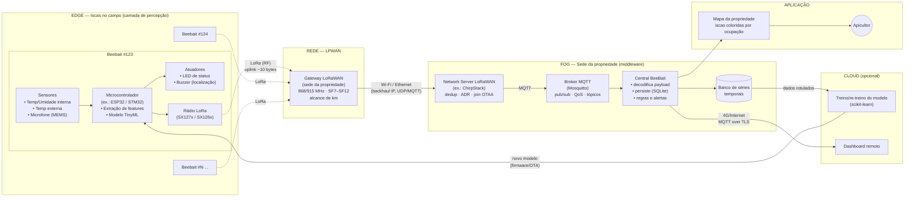
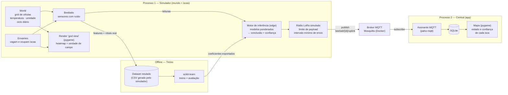
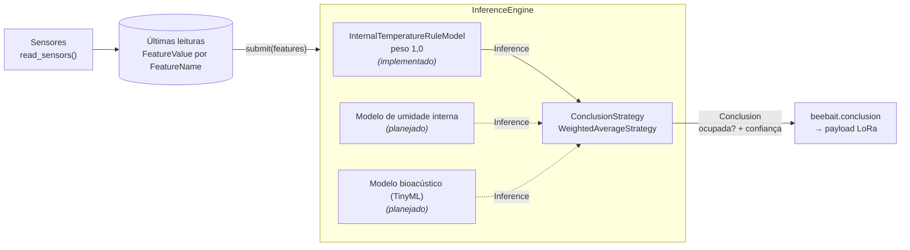

# BeeBait — Monitoramento Inteligente de Iscas para Enxames

> Projeto final da atividade acadêmica **Internet das Coisas e Aplicações de IA (Big Data)**.
>
> Solução simulada que combina **IoT** (sensores em iscas, LoRaWAN, MQTT) e **IA** (inferência na borda — TinyML) para indicar remotamente quais iscas de captura de enxames de abelhas estão ocupadas.

Github: [github.com/ffknob/beebait](github.com/ffknob/beebait)

---

## Sumário

1. [Contextualização](#1-contextualização)
2. [Arquitetura e Metodologia](#2-arquitetura-e-metodologia)
3. [Desenvolvimento e Funcionalidades](#3-desenvolvimento-e-funcionalidades)
4. [Análise de Resultados](#4-análise-de-resultados)
5. [Conclusões e Lições Aprendidas](#5-conclusões-e-lições-aprendidas)
6. [Instalação e Execução](#6-instalação-e-execução)
7. [Estrutura do Repositório](#7-estrutura-do-repositório)

---

## 1. Contextualização

### 1.1 Problema

Na apicultura, uma forma barata de iniciar ou ampliar um apiário é a **captura de enxames** com *iscas*: caixas (ou, de forma rudimentar, garrafas PET) preparadas com atrativos e instaladas em árvores. Quando um enxame ocupa uma isca, ela é levada ao apiário e acompanhada até produzir mel.

Em uma propriedade rural no norte do Rio Grande do Sul, um apicultor amador espalha muitas iscas por uma área extensa, o que traz dois problemas:

- **Verificação manual**: para saber quais iscas foram ocupadas, é preciso visitar *cada uma*, mesmo as que continuam vazias.
- **Perda de iscas**: como as iscas são fáceis de preparar e a propriedade oferece muitos pontos de captura, às vezes ele esquece onde as instalou.

### 1.2 Solução proposta

Acoplar a cada isca um **controlador IoT de baixo consumo** que:

1. identifica a isca de forma única e registra sua localização;
2. mede temperatura, umidade e áudio dentro da isca;
3. **infere localmente (na borda)**, com um modelo de IA leve, se a isca está ocupada e com qual confiança;
4. transmite apenas essa conclusão (poucos bytes) via **LoRaWAN** para uma central na sede da propriedade;
5. mostra, na central, um **mapa** com as iscas coloridas conforme seu estado.

Assim, o apicultor passa a visitar **apenas a sede e as iscas ocupadas**.

### 1.3 Justificativa e relevância

- **Sinergia IoT + IA**: só a IoT entregaria leituras brutas que alguém precisaria interpretar, e só a IA não teria dados do campo. Juntas, transformam sinais físicos (calor, som) em uma decisão acionável ("vá à isca 123").
- **Restrição real que justifica o edge**: não há cobertura celular e as distâncias são de quilômetros. O LoRaWAN cobre essa distância, mas transmite poucos bytes por mensagem, o que torna inviável enviar áudio. A inferência **precisa** acontecer na isca.
- **Base biológica**: uma colônia com cria mantém o ninho em torno de **34–35 °C**. Uma temperatura interna estável e acima da externa, somada à atividade sonora, é um forte indício de ocupação.
- **Área**: Agronegócio / Agricultura de precisão (apicultura).

### 1.4 Escopo deste trabalho

Como o foco é acadêmico, o **ambiente físico, os enxames e o rádio são simulados** em Python. Isso tem uma vantagem metodológica importante: o simulador conhece a **verdade de campo** (quais iscas estão de fato ocupadas), o que permite **gerar dados rotulados** para treinar o modelo e **validar** objetivamente as decisões do sistema.

---

## 2. Arquitetura e Metodologia

### 2.1 Visão geral (arquitetura de referência real)

O diagrama abaixo mostra a arquitetura que a solução teria em campo, organizada nas camadas clássicas de IoT: **percepção → rede → middleware/processamento → aplicação**, distribuídas entre **edge, fog e cloud**.



> Para gerar o PDF, use uma ferramenta que renderize Mermaid (ver [seção 6.4](#64-gerando-o-pdf-do-relatório)).

### 2.2 Conceitos de IoT aplicados

| Conceito | Onde aparece | Por que foi escolhido |
| --- | --- | --- |
| **Sensores / percepção** | Termo-higrômetro interno e externo, microfone MEMS | Medem os sinais físicos de uma colônia: calor estável (~34–35 °C), umidade e zumbido (~200–500 Hz). |
| **Atuadores** | LED piscante e buzzer | Indicam a ocupação no local e ajudam a encontrar a isca. |
| **Edge computing / TinyML** | Microcontrolador da isca | O áudio não cabe no rádio, então a isca envia só a *conclusão* (`ocupada, 92%`). Isso também economiza energia, porque o rádio fica desligado a maior parte do tempo. |
| **LoRa / LoRaWAN (LPWAN)** | Isca → gateway | Longo alcance (km), baixíssimo consumo e sem depender de operadora. O custo é a banda pequena (payload de ~51 a 222 bytes, conforme o *spreading factor*) e o *duty cycle* limitado. |
| **Gateway** | Sede | Recebe o RF de todas as iscas e repassa via IP. É um dispositivo "burro", que não interpreta o payload. |
| **Wi-Fi / Ethernet (backhaul)** | Gateway → servidor | A sede tem internet/rede local, então o tráfego segue por IP comum. |
| **Wi-Fi na instalação (opcional)** | Celular → isca | Na instalação, um app pode configurar a isca (ID, foto, GPS) por Wi-Fi ou BLE de curto alcance. |
| **MQTT** | Network server → central | Protocolo *publish/subscribe* leve, com broker, tópicos hierárquicos e QoS. É o padrão de fato em IoT. |
| **Fog computing** | Central na sede | Processa, armazena e alerta localmente, sem depender da nuvem. |
| **Cloud (opcional)** | Treino e dashboard remoto | Treina e re-treina o modelo sobre o histórico (Big Data) e permite acesso remoto. |
| **OTA (Over-the-Air)** | Cloud → isca | Distribui um modelo melhorado às iscas. |

### 2.3 Arquitetura implementada (simulação)

Na implementação, o hardware e o rádio são substituídos por componentes de software, mas as **fronteiras** da arquitetura real são preservadas:



| Componente real | Equivalente simulado |
| --- | --- |
| Ambiente físico (clima, árvores) | `world` — grid com campos de temperatura e umidade, ciclo diário e relógio simulado |
| Enxames de abelhas | Entidades `Swarm` (pacote `swarm`) que vagam pelo grid e ocupam iscas |
| Sensores da isca | Classes `Sensor` (pacote `beebait.sensor`) que leem o microclima da célula + ruído gaussiano |
| Microcontrolador + TinyML | `InferenceEngine` (pacote `beebait.inference`): submete as leituras a vários modelos e pondera os resultados. Hoje há um modelo de regra fixa; os modelos treinados entram no mesmo ponto |
| Rádio LoRa | Camada que impõe limite de bytes e intervalo de envio antes de publicar |
| Gateway + Network Server | Publicação direta no broker MQTT |
| Central / aplicação | Processo `app`: assinante MQTT, SQLite e mapa em pygame |

### 2.4 Tecnologias

| Tecnologia | Uso |
| --- | --- |
| **Python 3.13** | Linguagem principal |
| **uv** | Gerenciamento de ambiente e dependências |
| **pygame** | Visualização do mundo (heatmap) e da central (mapa) |
| **numpy** | *(planejado)* Extração de features das janelas de leituras |
| **paho-mqtt** | Cliente MQTT (publicação pelas iscas, assinatura pela central) |
| **Mosquitto** | Broker MQTT (via Docker) |
| **scikit-learn** | Treino e avaliação do classificador de ocupação |
| **PyTorch** *(planejado)* | Implementação real do modelo de inferência, que substituirá o mock atual (ver [Próximos passos](#51-próximos-passos)) |
| **SQLite** | Persistência da telemetria na central |

### 2.5 Metodologia

O desenvolvimento é **incremental**, com uma entrega funcional ao fim de cada fase:

1. **Mundo simulado** *(concluída)*: grid com temperatura e umidade espacialmente coerentes, ciclo dia/noite e relógio simulado desacoplado do FPS. Renderização como *heatmap*.
2. **Enxames e iscas** *(concluída)*: iscas posicionadas no mapa. Enxames vagam e ocupam iscas. Uma isca ocupada passa a ter microclima de colônia.
3. **Edge** *(em andamento)*: arquitetura de inferência na isca concluída, com um modelo de regra fixa sobre a temperatura interna. Faltam as features de janela de leituras e o payload compacto.
4. **IA**: geração do dataset rotulado, treino, avaliação e exportação do modelo para a isca.
5. **Comunicação e central**: MQTT, persistência e mapa do apicultor.
6. **Validação e documentação**: comparação entre a verdade de campo e a inferência, este relatório e o vídeo.

---

## 3. Desenvolvimento e Funcionalidades

### 3.1 Mundo simulado (`src/world`)

- **Grid** de `colunas × linhas` células (100 × 100 na aplicação), cada uma com valores de *features* ambientais (`Temperature`, `RelativeHumidity`), guardados como `FeatureValue` e identificados pelo enum `FeatureName`.
- Na criação do mundo, cada célula é amostrada a partir de estatísticas (`min`, `max`, `média`) com uma distribuição **Beta** reescalonada, o que mantém os valores dentro do intervalo e concentrados em torno da média. As células são preenchidas em ordem de linha e puxadas para perto da média das vizinhas já preenchidas, o que gera regiões quentes e frias **espacialmente coerentes**.
- A cada ciclo, cada célula (em ordem aleatória) caminha em direção a um **alvo**, no máximo `max_oscillation` por passo. Ao alcançar o alvo, sorteia outro:
  - perto do seu valor inicial (`max_base_deviation`), para que as regiões quentes e frias não se dissolvam;
  - a no máximo `max_neighbour_deviation` da média das 8 vizinhas, para manter o campo suave;
  - com probabilidade `excursion_probability`, o alvo é uma **excursão**: mais distante do valor inicial (até `max_excursion`) e sem a restrição das vizinhas, o que cria focos quentes ou frios que surgem e desaparecem.
- **Ciclo diário**: um deslocamento comum a todas as células, `A · cos(2π · (h − h_pico) / 24)`, somado ao valor local. A temperatura tem amplitude de 6 °C com pico às 15 h; a umidade, de 2 % com pico às 5 h.
- **Relógio simulado** desacoplado do FPS: o mundo avança `tempo real decorrido × time_scale`. O padrão é 600, ou seja, 1 s real = 10 min simulados (um dia em 144 s). O mundo começa às 6 h.
- Todos esses parâmetros ficam em `FeatureOptions` e `WorldParameters`.

### 3.2 Visualização (`src/app/render`)

- Arquitetura de *renderers* genéricos (`Renderer[T]`) configurados por *options* imutáveis (`@dataclass(frozen=True)`).
- `WorldRenderer` converte o `World` em um `RenderedGrid` desacoplado do domínio, e o `GridRenderer` desenha células e linhas.
- **Paleta de temperatura** (`app/shared/colors.py`) com 22 cores: uma abaixo de 0 °C, uma a cada 2 °C de 0 °C a 40 °C e uma acima de 40 °C (frio → quente).
- A janela (1280 × 900) é dividida em duas áreas:
  - **Mapa**: o *heatmap*, as iscas (`BeebaitRenderer`: magenta = vazia, azul = ocupada) e os enxames em movimento (`SwarmRenderer`: preto). À direita do mapa ficam o **relógio simulado** (`ClockRenderer`) e a **legenda** das cores (`LegendRenderer`).
  - **Painel inferior** (`BeebaitInfoRenderer`): lista de todas as iscas no formato `#123: 23º / 35º; occupied → O 80%` (temperatura externa / interna; estado real → conclusão da isca e confiança, com `O` = *occupied* (ocupada) e `E` = *empty* (vazia)). Iscas ocupadas aparecem em negrito e azul. Comparar o estado real com a conclusão mostra, na tela, quando a isca acerta ou erra.

### 3.3 Iscas e enxames (`src/beebait`, `src/swarm`)

- `Beebait(id, posição, sensores, motor de inferência)`: identificação única (0 a 65 535, pois o ID ocupa 2 bytes no payload) e localização no grid (`GridPosition`). Guarda o estado de ocupação real (`occupied`, verdade de campo usada só pela simulação), as últimas leituras como `FeatureValue` e a **conclusão** a que a própria isca chegou (`conclusion`, ver [3.4](#34-inferência-na-borda-srcbeebaitinference)).
- **Sensores** (`beebait.sensor`): a cada ciclo, a isca lê a célula onde está por meio dos seus sensores (`read_sensors`):
  - `ExternalTemperatureSensor`: temperatura da célula + ruído gaussiano;
  - `InternalTemperatureSensor`: ~34,5 °C com baixa variância se a isca estiver ocupada; caso contrário, acompanha o ambiente (~0,5 °C acima da externa). É uma simplificação: o sensor recebe a ocupação real para simular o microclima da colônia.
- `Swarm(id, posição)`: a aplicação cria metade do número de iscas em enxames (`TOTAL_SWARMS = 0,5 × TOTAL_BEEBAITS`), em posições aleatórias a pelo menos 3 células de qualquer isca, de modo que **todas as iscas começam vazias**.
- A cada ciclo, cada enxame se move para uma célula vizinha aleatória dentro do grid. Se ficar na célula de uma isca vazia ou em uma de suas 8 vizinhas, **ocupa a isca** e deixa de se mover. Cada isca recebe um único enxame.
- O ciclo da aplicação (`cycle`) atualiza o mundo, move os enxames, resolve as ocupações e, por fim, faz cada isca ler seus sensores (`read_sensors`) e submeter as leituras ao motor de inferência (`infer`).
- **Evolução planejada**: enxames que surgem na época de enxameação e escolhem iscas pela atratividade (sombra, temperatura); umidade interna elevada e "sinal acústico" representado por features (energia e frequência dominante), sem gerar áudio de verdade.

### 3.4 Inferência na borda (`src/beebait/inference`)

A isca não envia leituras brutas: ela as **submete a modelos de inferência** localmente e transmite só a conclusão. A decisão de ocupação não vem de um único modelo. Cada modelo olha para um aspecto (temperatura, umidade, som...) e dá sua própria inferência, e as inferências são **ponderadas** para formar a conclusão final.



**Componentes**

| Classe | Papel |
| --- | --- |
| `InferenceModel` | Classe base de um modelo. Declara as features de que precisa (`required_features`) e expõe `infer(features)`. Primeiro confere se todas as leituras necessárias existem; se faltar alguma, o modelo não opina (retorna `None`). Depois monta o vetor de entrada (`_extract_input`) e chama `_predict`. Um modelo treinado só precisa implementar `_predict`. |
| `InternalTemperatureRuleModel` | Modelo atual, uma **regra fixa** que ocupa o lugar de um modelo treinado: a isca é considerada ocupada se a temperatura interna estiver entre **33 °C e 36 °C** (faixa em que uma colônia mantém a cria). Responde sempre com confiança fixa de 80 %. |
| `Inference` | Resultado de um modelo: nome do modelo, ocupada ou não e confiança (0 a 1). |
| `ConclusionStrategy` | Interface da ponderação: recebe pares (inferência, peso) e devolve uma `Conclusion`. Permite trocar a forma de ponderar sem mexer nos modelos. |
| `WeightedAverageStrategy` | Ponderação atual: média ponderada das probabilidades de ocupação. |
| `Conclusion` | Decisão final: ocupada ou não, confiança e as inferências que a geraram (útil para auditar a decisão). |
| `InferenceEngine` | O *middleware* da isca. Guarda os modelos com seus pesos (`add_model(model, weight)`) e a estratégia. `submit(features)` roda todos os modelos e pondera os resultados. |

**Ponderação.** Cada inferência *i*, com peso *wᵢ* e confiança *cᵢ*, vira uma probabilidade de ocupação *pᵢ* = *cᵢ* se o modelo disse "ocupada" ou 1 − *cᵢ* se disse "vazia". A probabilidade final é

```
P(ocupada) = Σ wᵢ · pᵢ / Σ wᵢ
```

A isca conclui "ocupada" se *P* ≥ 0,5 (limiar configurável), com confiança *P*, e "vazia" caso contrário, com confiança 1 − *P*. Por exemplo, um modelo com peso 2 que diz "ocupada" com 90 % e outro com peso 1 que diz "vazia" com 80 % dão *P* = (2 · 0,9 + 1 · 0,2) / 3 ≈ 0,67, ou seja, ocupada com 67 % de confiança. Modelos sem leituras suficientes ficam de fora; se nenhum modelo puder opinar, não há conclusão.

**Limitações atuais.** Com um único modelo, a conclusão é a própria regra. O sensor interno simulado gera ~34,5 °C quando a isca está ocupada, então a regra acerta quase sempre. Mas uma isca vazia em um dia muito quente (temperatura externa acima de ~32,5 °C) pode ser confundida com uma ocupada. É justamente esse tipo de erro que os próximos modelos e a ponderação devem corrigir.

**Próximos modelos** (planejados), calculados sobre uma janela das últimas *N* leituras:

| Feature | Intuição |
| --- | --- |
| `ΔT = T_interna − T_externa` | Uma colônia aquece o ninho |
| `σ(T_interna)` | Uma colônia **estabiliza** a temperatura; uma isca vazia acompanha o ambiente |
| `UR_interna` | A atividade da colônia eleva a umidade |
| `energia_acústica` | O zumbido indica presença |
| `freq_dominante` | Separa abelhas de outros ruídos |

Esses modelos serão treinados offline (PyTorch ou similar) e exportados para rodar na isca, imitando o que seria um modelo TinyML num microcontrolador. Entram no motor como mais um `InferenceModel`, com seu peso. O plano está em [Próximos passos](#51-próximos-passos).

### 3.5 Protocolo de comunicação *(planejado)*

**Payload LoRa (uplink)**: compacto, respeitando o limite do rádio:

```
123:O:92        → isca 123, Occupied (ocupada), confiança 92%
123:E:88        → isca 123, Empty (vazia), confiança 88%
```

| Campo | Tamanho (binário) | Descrição |
| --- | --- | --- |
| ID da isca | 2 bytes | até 65 535 iscas |
| Estado | 1 byte | `E` *empty* (vazia) / `O` *occupied* (ocupada) |
| Confiança | 1 byte | 0–100 % |
| Temp. interna (opcional) | 2 bytes | °C × 100 |
| Bateria (opcional) | 1 byte | % |

**Tópicos MQTT**:

| Tópico | Direção | Conteúdo |
| --- | --- | --- |
| `beebait/{id}/uplink` | isca → central | estado, confiança e telemetria resumida |
| `beebait/{id}/status` | isca → central | *heartbeat* / bateria (mensagem *retained*) |
| `beebait/{id}/downlink` | central → isca | comandos (ex.: acionar buzzer) |

O uplink usa **QoS 1** (pelo menos uma entrega), adequado para eventos de ocupação que não podem se perder.

### 3.6 Central do apicultor *(planejado)*

- Assina `beebait/+/uplink`, decodifica e persiste em SQLite.
- Mapa com as iscas coloridas: **verde** = vazia, **laranja** = ocupada, **cinza** = sem sinal. A opacidade é proporcional à confiança.
- Alerta de isca **sem comunicação** há mais de *X* horas (bateria, roubo, defeito).

---

## 4. Análise de Resultados

> *Seção a ser preenchida conforme os experimentos forem executados.*

### 4.1 Validação do modelo de ocupação

O simulador conhece a ocupação real, então o modelo é avaliado em um conjunto de teste separado:

| Métrica | Valor |
| --- | --- |
| Acurácia | *a preencher* |
| Precisão (ocupada) | *a preencher* |
| Recall (ocupada) | *a preencher* |
| F1-score | *a preencher* |

- Matriz de confusão: *a inserir*
- Importância das features: *a inserir*. A hipótese é que `ΔT` e `σ(T_interna)` sejam as mais relevantes.

### 4.2 Validação do sistema ponta a ponta

- **Tempo até detecção**: quanto tempo simulado se passa entre a ocupação real e a central exibir "ocupada".
- **Falsos alarmes**: visitas desnecessárias evitadas *vs.* visitas desnecessárias provocadas.
- **Economia estimada**: visitas com o sistema *vs.* visitar todas as iscas periodicamente.
- **Uso de banda**: bytes por mensagem e mensagens por isca por dia, comparados com os limites do LoRaWAN.

### 4.3 Insights

*A preencher (ex.: quais regiões do mapa mais atraem enxames, horários de maior confiança na detecção).*

---

## 5. Conclusões e Lições Aprendidas

> *Seção a ser consolidada ao final do projeto.*

Pontos já observados:

- **Restrição de rede como requisito de arquitetura**: a limitação do LoRaWAN não é só um detalhe. É ela que *obriga* a IA a rodar na borda, o que ilustra bem a divisão edge/fog/cloud.
- **Simulação como fonte de dados rotulados**: na ausência de hardware e de um histórico real, simular o ambiente permitiu treinar e validar o modelo. A limitação é que o modelo aprende o comportamento *do simulador*, não de colônias reais.
- **Separação domínio × visualização**: desacoplar o `World` dos *renderers* facilitou evoluir a simulação sem quebrar a interface.

### 5.1 Próximos passos

**Implementação do modelo de inferência** *(componente ainda faltante)*

O `InternalTemperatureRuleModel` é apenas um **mock**: uma regra fixa (temperatura interna entre 33 °C e 36 °C) com confiança constante, que ocupa o lugar de um modelo de verdade só para validar a arquitetura de inferência. O código está marcado com um `TODO`. Para implementá-lo:

1. **Dataset**: gerar, com o simulador, leituras rotuladas com a ocupação real (`beebait.occupied`), incluindo situações difíceis como dias muito quentes com a isca vazia.
2. **Features**: calcular as features de janela descritas em [3.4](#34-inferência-na-borda-srcbeebaitinference) (`ΔT`, `σ(T_interna)`, umidade interna, energia acústica, frequência dominante).
3. **Treino**: treinar um modelo pequeno com **PyTorch** (ou similar), por exemplo uma rede densa rasa ou uma regressão logística, e avaliá-lo com precisão, recall, F1 e matriz de confusão (seção [4.1](#41-validação-do-modelo-de-ocupação)).
4. **Exportação para a borda**: exportar o modelo treinado (por exemplo TorchScript ou ONNX, com quantização) num formato leve, adequado a um microcontrolador (TinyML).
5. **Integração**: criar uma subclasse de `InferenceModel` que carrega o modelo exportado e o executa em `_predict`, e registrá-la no `InferenceEngine` com o seu peso. A confiança passa a ser a probabilidade dada pelo modelo, e não mais um valor fixo.

**Demais etapas pendentes**

- Payload compacto e rádio LoRa simulado (limite de bytes e intervalo de envio).
- Publicação via MQTT e central do apicultor (assinante, SQLite e mapa).
- Validação ponta a ponta e preenchimento da [Análise de Resultados](#4-análise-de-resultados).

### 5.2 Trabalhos futuros

- Hardware real (ESP32 + LoRa + sensores) e coleta de áudio real de colônias.
- Modelo de bioacústica para presença de rainha, saúde da colônia e preparação para enxamear.
- GPS para detectar mudança de posição (roubo, queda).
- Buzzer acionável por downlink para encontrar a isca.
- Contagem de abelhas na entrada com sensores de passagem (laser).
- Estudo de energia (painel solar + bateria) e de custo por isca.

---

## 6. Instalação e Execução

### 6.1 Pré-requisitos

- Python **3.13+**
- [uv](https://docs.astral.sh/uv/)
- Docker *(para o broker MQTT, quando a comunicação estiver implementada)*

### 6.2 Instalação

```bash
git clone <url-do-repositorio>
cd beebait
uv sync
```

### 6.3 Execução

```bash
# Simulador do mundo, iscas e enxames (heatmap)
uv run app

# (planejado) Broker MQTT
docker run -d --name mosquitto -p 1883:1883 eclipse-mosquitto

# (planejado) Simulador de iscas e central
uv run mundo
uv run beebait
```

---

## 7. Estrutura do Repositório

```
beebait/
├── README.md                 # Este documento (relatório)
├── pyproject.toml
└── src/
    ├── world/                # Simulação do ambiente físico
    │   ├── enums/            #   nomes das features (FeatureName)
    │   ├── feature/          #   Temperature, RelativeHumidity, FeatureValue
    │   ├── model/            #   parâmetros, estatísticas, opções e GridPosition
    │   └── world/            #   World (grid, relógio) e Cell
    ├── beebait/              # Firmware simulado da isca
    │   ├── beebait/          #   Beebait
    │   ├── inference/        #   motor de inferência, modelos e ponderação
    │   └── sensor/           #   sensores de temperatura interna e externa
    ├── swarm/                # Enxames
    │   └── swarm/            #   Swarm
    └── app/                  # Visualização e (futura) central
        ├── main.py           #   criação do mundo, iscas, enxames e ciclo principal
        ├── model/            #   RenderedGrid, RenderedCell, LegendEntry
        ├── render/           #   renderers (world, grid, cell, beebait, beebait_info,
        │                     #   swarm, clock, legend)
        └── shared/           #   cores
```

---

## Equipe

Flávio Knob
