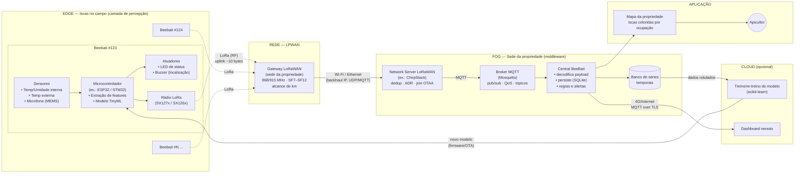
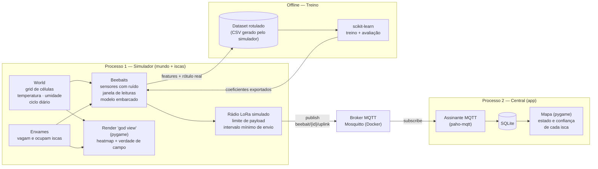

# BeeBait — Monitoramento Inteligente de Iscas para Enxames

> Projeto final da atividade acadêmica **Internet das Coisas e Aplicações de IA (Big Data)**.
>
> Solução simulada que combina **IoT** (sensores em iscas, LoRaWAN, MQTT) e **IA** (inferência na borda — TinyML) para indicar remotamente quais iscas de captura de enxames de abelhas estão ocupadas.

Github: [github.com/ffknob/beebait](github.com/ffknob/beebait)

---

## Sumário

1. [Contextualização](#1-contextualização)
2. [Arquitetura e Metodologia](#2-arquitetura-e-metodologia)
3. [Desenvolvimento e Funcionalidades](#3-desenvolvimento-e-funcionalidades)
4. [Análise de Resultados](#4-análise-de-resultados)
5. [Conclusões e Lições Aprendidas](#5-conclusões-e-lições-aprendidas)
6. [Instalação e Execução](#6-instalação-e-execução)
7. [Estrutura do Repositório](#7-estrutura-do-repositório)

---

## 1. Contextualização

### 1.1 Problema

Na apicultura, uma forma barata de iniciar ou ampliar um apiário é a **captura de enxames** com *iscas*: caixas (ou, de forma rudimentar, garrafas PET) preparadas com atrativos e instaladas em árvores. Quando um enxame ocupa uma isca, ela é levada ao apiário e acompanhada até produzir mel.

Em uma propriedade rural no norte do Rio Grande do Sul, um apicultor amador espalha muitas iscas por uma área extensa, o que traz dois problemas:

- **Verificação manual**: para saber quais iscas foram ocupadas, é preciso visitar *cada uma*, mesmo as que continuam vazias.
- **Perda de iscas**: como as iscas são fáceis de preparar e a propriedade oferece muitos pontos de captura, às vezes ele esquece onde as instalou.

### 1.2 Solução proposta

Acoplar a cada isca um **controlador IoT de baixo consumo** que:

1. identifica a isca de forma única e registra sua localização;
2. mede temperatura, umidade e áudio dentro da isca;
3. **infere localmente (na borda)**, com um modelo de IA leve, se a isca está ocupada e com qual confiança;
4. transmite apenas essa conclusão (poucos bytes) via **LoRaWAN** para uma central na sede da propriedade;
5. mostra, na central, um **mapa** com as iscas coloridas conforme seu estado.

Assim, o apicultor passa a visitar **apenas a sede e as iscas ocupadas**.

### 1.3 Justificativa e relevância

- **Sinergia IoT + IA**: só a IoT entregaria leituras brutas que alguém precisaria interpretar, e só a IA não teria dados do campo. Juntas, transformam sinais físicos (calor, som) em uma decisão acionável ("vá à isca 123").
- **Restrição real que justifica o edge**: não há cobertura celular e as distâncias são de quilômetros. O LoRaWAN cobre essa distância, mas transmite poucos bytes por mensagem, o que torna inviável enviar áudio. A inferência **precisa** acontecer na isca.
- **Base biológica**: uma colônia com cria mantém o ninho em torno de **34–35 °C**. Uma temperatura interna estável e acima da externa, somada à atividade sonora, é um forte indício de ocupação.
- **Área**: Agronegócio / Agricultura de precisão (apicultura).

### 1.4 Escopo deste trabalho

Como o foco é acadêmico, o **ambiente físico, os enxames e o rádio são simulados** em Python. Isso tem uma vantagem metodológica importante: o simulador conhece a **verdade de campo** (quais iscas estão de fato ocupadas), o que permite **gerar dados rotulados** para treinar o modelo e **validar** objetivamente as decisões do sistema.

---

## 2. Arquitetura e Metodologia

### 2.1 Visão geral (arquitetura de referência real)

O diagrama abaixo mostra a arquitetura que a solução teria em campo, organizada nas camadas clássicas de IoT: **percepção → rede → middleware/processamento → aplicação**, distribuídas entre **edge, fog e cloud**.



> Para gerar o PDF, use uma ferramenta que renderize Mermaid (ver [seção 6.4](#64-gerando-o-pdf-do-relatório)).

### 2.2 Conceitos de IoT aplicados

| Conceito | Onde aparece | Por que foi escolhido |
| --- | --- | --- |
| **Sensores / percepção** | Termo-higrômetro interno e externo, microfone MEMS | Medem os sinais físicos de uma colônia: calor estável (~34–35 °C), umidade e zumbido (~200–500 Hz). |
| **Atuadores** | LED piscante e buzzer | Indicam a ocupação no local e ajudam a encontrar a isca. |
| **Edge computing / TinyML** | Microcontrolador da isca | O áudio não cabe no rádio, então a isca envia só a *conclusão* (`ocupada, 92%`). Isso também economiza energia, porque o rádio fica desligado a maior parte do tempo. |
| **LoRa / LoRaWAN (LPWAN)** | Isca → gateway | Longo alcance (km), baixíssimo consumo e sem depender de operadora. O custo é a banda pequena (payload de ~51 a 222 bytes, conforme o *spreading factor*) e o *duty cycle* limitado. |
| **Gateway** | Sede | Recebe o RF de todas as iscas e repassa via IP. É um dispositivo "burro", que não interpreta o payload. |
| **Wi-Fi / Ethernet (backhaul)** | Gateway → servidor | A sede tem internet/rede local, então o tráfego segue por IP comum. |
| **Wi-Fi na instalação (opcional)** | Celular → isca | Na instalação, um app pode configurar a isca (ID, foto, GPS) por Wi-Fi ou BLE de curto alcance. |
| **MQTT** | Network server → central | Protocolo *publish/subscribe* leve, com broker, tópicos hierárquicos e QoS. É o padrão de fato em IoT. |
| **Fog computing** | Central na sede | Processa, armazena e alerta localmente, sem depender da nuvem. |
| **Cloud (opcional)** | Treino e dashboard remoto | Treina e re-treina o modelo sobre o histórico (Big Data) e permite acesso remoto. |
| **OTA (Over-the-Air)** | Cloud → isca | Distribui um modelo melhorado às iscas. |

### 2.3 Arquitetura implementada (simulação)

Na implementação, o hardware e o rádio são substituídos por componentes de software, mas as **fronteiras** da arquitetura real são preservadas:



| Componente real | Equivalente simulado |
| --- | --- |
| Ambiente físico (clima, árvores) | `world` — grid com campos de temperatura e umidade |
| Enxames de abelhas | Entidades `Swarm` com comportamento probabilístico |
| Sensores da isca | Leitura do microclima da célula/isca + ruído gaussiano |
| Microcontrolador + TinyML | Classe `Beebait` com inferência em Python puro, usando coeficientes exportados |
| Rádio LoRa | Camada que impõe limite de bytes e intervalo de envio antes de publicar |
| Gateway + Network Server | Publicação direta no broker MQTT |
| Central / aplicação | Processo `app`: assinante MQTT, SQLite e mapa em pygame |

### 2.4 Tecnologias

| Tecnologia | Uso |
| --- | --- |
| **Python 3.13** | Linguagem principal |
| **uv** | Gerenciamento de ambiente e dependências |
| **pygame** | Visualização do mundo (heatmap) e da central (mapa) |
| **numpy** | Geração dos campos ambientais (ruído suavizado, ciclo diário) |
| **paho-mqtt** | Cliente MQTT (publicação pelas iscas, assinatura pela central) |
| **Mosquitto** | Broker MQTT (via Docker) |
| **scikit-learn** | Treino e avaliação do classificador de ocupação |
| **SQLite** | Persistência da telemetria na central |

### 2.5 Metodologia

O desenvolvimento é **incremental**, com uma entrega funcional ao fim de cada fase:

1. **Mundo simulado**: grid com temperatura e umidade espacialmente coerentes, ciclo dia/noite e relógio simulado desacoplado do FPS. Renderização como *heatmap*.
2. **Enxames e iscas**: iscas posicionadas no mapa. Enxames surgem, vagam e ocupam iscas. Uma isca ocupada passa a ter microclima de colônia.
3. **Edge**: cada isca extrai features de uma janela de leituras e produz um payload compacto.
4. **IA**: geração do dataset rotulado, treino, avaliação e exportação do modelo para a isca.
5. **Comunicação e central**: MQTT, persistência e mapa do apicultor.
6. **Validação e documentação**: comparação entre a verdade de campo e a inferência, este relatório e o vídeo.

---

## 3. Desenvolvimento e Funcionalidades

### 3.1 Mundo simulado (`src/world`)

- **Grid** de `colunas × linhas` células, cada uma com valores de *features* ambientais (`Temperature`, `RelativeHumidity`).
- Cada feature é amostrada a partir de estatísticas (`min`, `max`, `média`) com uma distribuição **Beta** reescalonada, o que mantém os valores dentro do intervalo e concentrados em torno da média.
- **Evolução planejada** para dar realismo:
  - campo base espacialmente suave (ruído suavizado), para que células vizinhas tenham temperaturas parecidas;
  - ciclo diário: `T(x, y, t) = base(x, y) + A · sin(2π · t / 24h) + ε`;
  - relógio simulado (ex.: 1 s real = 10 min simulados).

### 3.2 Visualização (`src/app/render`)

- Arquitetura de *renderers* genéricos (`Renderer[T]`) configurados por *options* imutáveis (`@dataclass(frozen=True)`).
- `WorldRenderer` converte o `World` em um `RenderedGrid` desacoplado do domínio, e o `GridRenderer` desenha células e linhas.
- **Paleta de temperatura** com 25 cores, uma a cada 2 °C, de −10 °C a +40 °C (frio → quente).

### 3.3 Iscas e enxames *(planejado)*

- `Beebait(id, posição)`: identificação única e localização no grid.
- `Swarm`: surge aleatoriamente na época de enxameação e escolhe uma isca próxima com probabilidade proporcional à sua atratividade (sombra, temperatura).
- Isca ocupada: temperatura interna de ~34–35 °C com baixa variância, umidade elevada e "sinal acústico" representado por features (energia e frequência dominante), sem gerar áudio de verdade.

### 3.4 Inferência na borda *(planejado)*

Features calculadas pela isca sobre uma janela das últimas *N* leituras:

| Feature | Intuição |
| --- | --- |
| `ΔT = T_interna − T_externa` | Uma colônia aquece o ninho |
| `σ(T_interna)` | Uma colônia **estabiliza** a temperatura; uma isca vazia acompanha o ambiente |
| `UR_interna` | A atividade da colônia eleva a umidade |
| `energia_acústica` | O zumbido indica presença |
| `freq_dominante` | Separa abelhas de outros ruídos |

O modelo, uma regressão logística ou árvore rasa treinada offline, tem seus coeficientes exportados e roda em **Python puro** na isca, imitando o que seria um modelo TinyML num microcontrolador.

### 3.5 Protocolo de comunicação *(planejado)*

**Payload LoRa (uplink)**: compacto, respeitando o limite do rádio:

```
123:O:92        → isca 123, Ocupada, confiança 92%
123:V:88        → isca 123, Vazia, confiança 88%
```

| Campo | Tamanho (binário) | Descrição |
| --- | --- | --- |
| ID da isca | 2 bytes | até 65 535 iscas |
| Estado | 1 byte | `V` vazia / `O` ocupada |
| Confiança | 1 byte | 0–100 % |
| Temp. interna (opcional) | 2 bytes | °C × 100 |
| Bateria (opcional) | 1 byte | % |

**Tópicos MQTT**:

| Tópico | Direção | Conteúdo |
| --- | --- | --- |
| `beebait/{id}/uplink` | isca → central | estado, confiança e telemetria resumida |
| `beebait/{id}/status` | isca → central | *heartbeat* / bateria (mensagem *retained*) |
| `beebait/{id}/downlink` | central → isca | comandos (ex.: acionar buzzer) |

O uplink usa **QoS 1** (pelo menos uma entrega), adequado para eventos de ocupação que não podem se perder.

### 3.6 Central do apicultor *(planejado)*

- Assina `beebait/+/uplink`, decodifica e persiste em SQLite.
- Mapa com as iscas coloridas: **verde** = vazia, **laranja** = ocupada, **cinza** = sem sinal. A opacidade é proporcional à confiança.
- Alerta de isca **sem comunicação** há mais de *X* horas (bateria, roubo, defeito).

---

## 4. Análise de Resultados

> *Seção a ser preenchida conforme os experimentos forem executados.*

### 4.1 Validação do modelo de ocupação

O simulador conhece a ocupação real, então o modelo é avaliado em um conjunto de teste separado:

| Métrica | Valor |
| --- | --- |
| Acurácia | *a preencher* |
| Precisão (ocupada) | *a preencher* |
| Recall (ocupada) | *a preencher* |
| F1-score | *a preencher* |

- Matriz de confusão: *a inserir*
- Importância das features: *a inserir*. A hipótese é que `ΔT` e `σ(T_interna)` sejam as mais relevantes.

### 4.2 Validação do sistema ponta a ponta

- **Tempo até detecção**: quanto tempo simulado se passa entre a ocupação real e a central exibir "ocupada".
- **Falsos alarmes**: visitas desnecessárias evitadas *vs.* visitas desnecessárias provocadas.
- **Economia estimada**: visitas com o sistema *vs.* visitar todas as iscas periodicamente.
- **Uso de banda**: bytes por mensagem e mensagens por isca por dia, comparados com os limites do LoRaWAN.

### 4.3 Insights

*A preencher (ex.: quais regiões do mapa mais atraem enxames, horários de maior confiança na detecção).*

---

## 5. Conclusões e Lições Aprendidas

> *Seção a ser consolidada ao final do projeto.*

Pontos já observados:

- **Restrição de rede como requisito de arquitetura**: a limitação do LoRaWAN não é só um detalhe. É ela que *obriga* a IA a rodar na borda, o que ilustra bem a divisão edge/fog/cloud.
- **Simulação como fonte de dados rotulados**: na ausência de hardware e de um histórico real, simular o ambiente permitiu treinar e validar o modelo. A limitação é que o modelo aprende o comportamento *do simulador*, não de colônias reais.
- **Separação domínio × visualização**: desacoplar o `World` dos *renderers* facilitou evoluir a simulação sem quebrar a interface.

### Trabalhos futuros

- Hardware real (ESP32 + LoRa + sensores) e coleta de áudio real de colônias.
- Modelo de bioacústica para presença de rainha, saúde da colônia e preparação para enxamear.
- GPS para detectar mudança de posição (roubo, queda).
- Buzzer acionável por downlink para encontrar a isca.
- Contagem de abelhas na entrada com sensores de passagem (laser).
- Estudo de energia (painel solar + bateria) e de custo por isca.

---

## 6. Instalação e Execução

### 6.1 Pré-requisitos

- Python **3.13+**
- [uv](https://docs.astral.sh/uv/)
- Docker *(para o broker MQTT, quando a comunicação estiver implementada)*

### 6.2 Instalação

```bash
git clone <url-do-repositorio>
cd beebait
uv sync
```

### 6.3 Execução

```bash
# Simulador do mundo (heatmap)
uv run app

# (planejado) Broker MQTT
docker run -d --name mosquitto -p 1883:1883 eclipse-mosquitto

# (planejado) Simulador de iscas e central
uv run mundo
uv run beebait
```

---

## 7. Estrutura do Repositório

```
beebait/
├── README.md                 # Este documento (relatório)
├── pyproject.toml
└── src/
    ├── world/                # Simulação do ambiente físico
    │   ├── enums/            #   nomes das features
    │   ├── feature/          #   Temperature, RelativeHumidity (amostragem)
    │   ├── model/            #   parâmetros e estatísticas
    │   └── world/            #   World (grid) e Cell
    ├── app/                  # Visualização e (futura) central
    │   ├── model/            #   RenderedGrid, RenderedCell
    │   ├── render/           #   Renderers (world, grid, cell)
    │   └── shared/           #   cores
    └── beebait/              # (planejado) firmware simulado da isca
```

---

## Equipe

Flávio Knob
